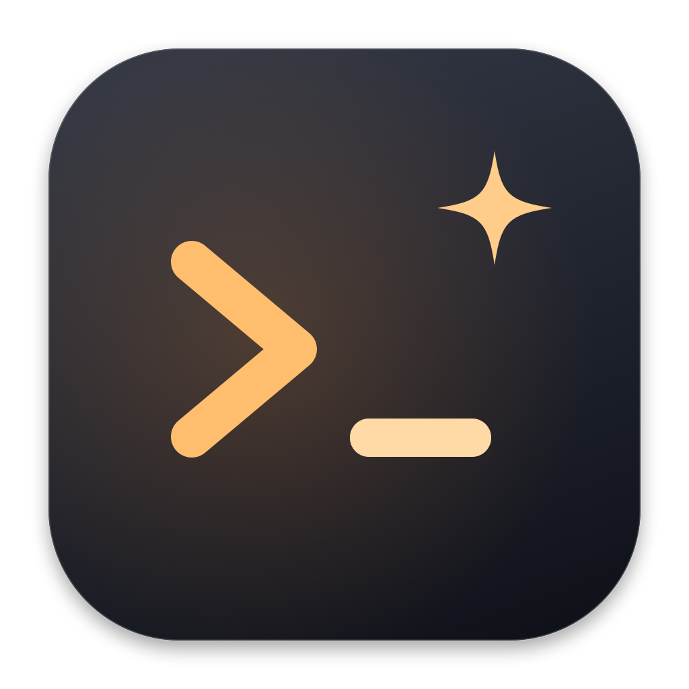
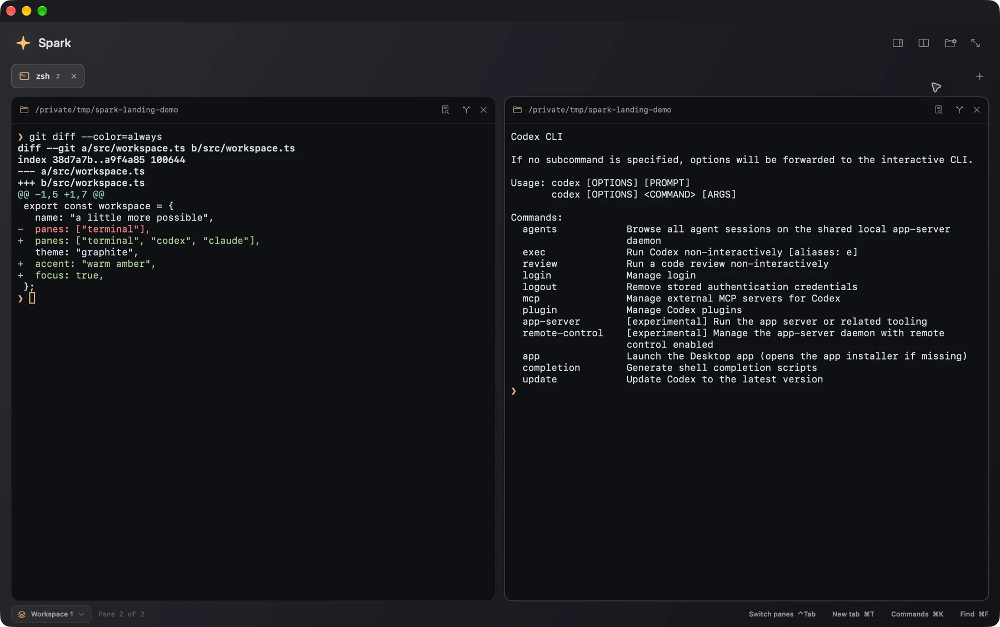
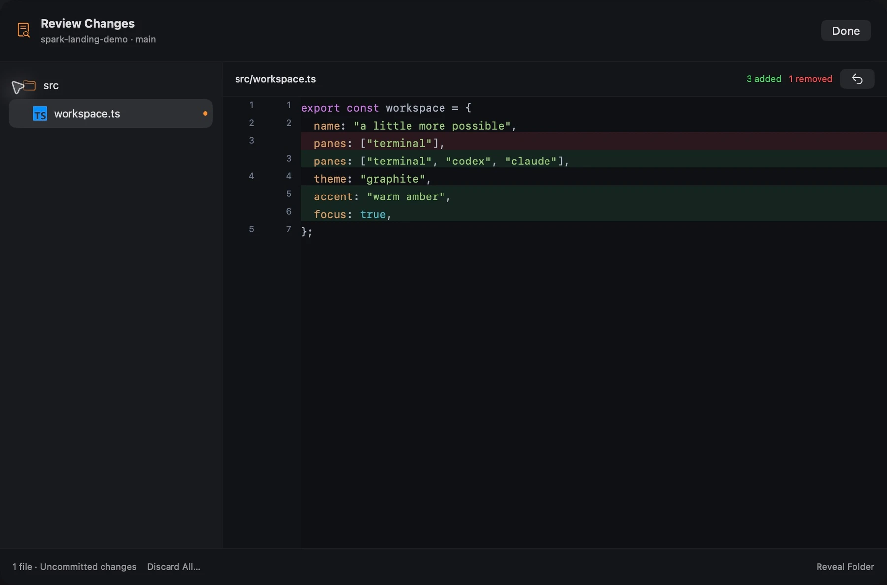

<p align="center">
  
</p>
<h1 align="center">Spark</h1>
<p align="center"><strong>A little more possible.</strong></p>
<p align="center">A native, open-source macOS terminal for your shell, your AI agents, and your next big idea.</p>
<p align="center">
  <a href="https://spark.lucasarch.com">Website</a> ·
  <a href="https://github.com/lucasaarch/Spark/releases">Downloads</a> ·
  <a href="docs/user-guide.md">User guide</a> ·
  <a href="CONTRIBUTING.md">Contributing</a>
</p>
<p align="center">
  <a href="https://github.com/lucasaarch/Spark/actions/workflows/ci.yml"></a>
  <a href="LICENSE"></a>
  
</p>



Spark brings your shell, Codex, Claude Code, and Git workflow into one native Mac app. Organize projects into persistent workspaces, run agents alongside your tools, and review changes without leaving the terminal.

Built with SwiftUI and AppKit, powered by [SwiftTerm](https://github.com/migueldeicaza/SwiftTerm), with updates through [Sparkle](https://sparkle-project.org).

## Features

- **A native terminal.** Real PTY sessions, your existing shell configuration, GPU rendering, true color, search, and adjustable typography.
- **Workspaces that stay with you.** Save tabs, directories, split layouts, and window geometry. Switch projects while other workspaces keep running in the background.
- **Split panes.** Keyboard shortcuts, ready-made layouts, and resizable panes for shells, servers, tests, and agents side by side.
- **Agent awareness.** Codex and Claude Code status colors, animated activity, context and usage metrics, and macOS notifications when attention is needed.
- **Conversation continuity.** An activity panel for running agents and recent conversations, with one-click resume through the original CLI.
- **Git worktrees per terminal.** Create an isolated branch and working folder from the focused project, then merge back with clean-tree checks and conflict previews.
- **Native code review.** A file tree, language icons, syntax highlighting, line numbers, and live diffs driven by filesystem events. Discard uncommitted changes with a recovery copy.
- **Keyboard-first navigation.** A searchable command palette, pane switching, tab navigation, and focus mode.



## Install

Spark requires **macOS 14 Sonoma or later**. Release builds support **Apple Silicon and Intel**.

Download **Spark-1.1.0.dmg** from [GitHub Releases](https://github.com/lucasaarch/Spark/releases/latest), open it, and drag **Spark** into **Applications**. Both the app and disk image are signed with Developer ID and notarized by Apple. Future updates arrive through Sparkle.

The release also includes a ZIP for the updater and SHA-256 checksums for both downloads.

Codex and Claude Code are optional and installed separately. Spark works as a regular terminal without an AI account. Provider subscriptions and API charges are separate from Spark.

## Get started

1. Open a terminal and use your existing shell and tools.
2. Press **⌘D** to split a pane, or choose a layout from the toolbar.
3. Use the footer switcher to create or change workspaces.
4. Run `codex` or `claude` in a new zsh pane to connect agent status and usage.
5. In a Git repository, use the pane's branch and review buttons to work with worktrees and changes.

| Action | Shortcut |
| --- | --- |
| Command palette | ⌘K |
| New tab / window | ⌘T / ⌘N |
| Split right / below | ⌘D / ⇧⌘D |
| Next pane | ⌃Tab |
| Previous / next tab | ⇧⌘[ / ⇧⌘] |
| Close focused pane | ⌘W |
| Activity and recent conversations | ⇧⌘A |
| New worktree | ⇧⌘N |
| Review changes | ⇧⌘G |
| Find | ⌘F |
| Settings | ⌘, |

See the [user guide](docs/user-guide.md) for the full shortcut list, integration details, and supported workflows.

## Build from source

Use **Xcode 26.2 or newer** with Swift 6.2 or newer. CI uses Xcode 26.6. Swift packages are pinned in `Package.resolved`.

```sh
git clone https://github.com/lucasaarch/Spark.git
cd Spark
open Spark.xcodeproj
```

Select the **Spark** scheme, choose your development team, and run. To build and test without a signing identity:

```sh
./scripts/lint.sh
./scripts/check.sh
open .build/DerivedData/Build/Products/Debug/Spark.app
```

The lint script uses SwiftLint **0.65.1**, downloading a checksum-verified binary if that version is not installed. Tests exercise real PTYs, workspace lifecycle, agent integrations, Git operations, and native review components. CI also builds a universal Release app. See [Contributing](CONTRIBUTING.md) for formatting and UI testing.

## Local data and privacy

Spark stores workspace layouts, directories, and references to CLI conversations locally. Restoring a workspace starts fresh shells; it does not restart commands or agents, and workspace files do not retain scrollback or conversation contents.

Agent metrics come from the running CLI's terminal reports or local status-line integration. Spark does not read API keys, scan conversation transcripts, or call provider billing APIs for these metrics. Availability depends on the CLI version and reported fields. Missing usage data is shown as unavailable.

Spark is distributed outside the App Store and is not sandboxed, so your shell and tools can access the files they need. Notification delivery is managed in **System Settings → Notifications → Spark**.

## Contributing

Bug reports, focused improvements, and documentation contributions are welcome. Start with [CONTRIBUTING.md](CONTRIBUTING.md), and use [GitHub Issues](https://github.com/lucasaarch/Spark/issues) for reproducible bugs and feature proposals. For security concerns, see [SECURITY.md](SECURITY.md).

Maintainers can find signing, notarization, and update instructions in the [release guide](docs/releasing.md).

## License and acknowledgments

Spark is available under the [MIT license](LICENSE).

Thanks to [SwiftTerm](https://github.com/migueldeicaza/SwiftTerm), [Sparkle](https://sparkle-project.org), [HighlighterSwift](https://github.com/smittytone/HighlighterSwift), [Simple Icons](https://simpleicons.org), and [ThinkingOrbsKit](https://github.com/Jakubantalik/Libraries.dev) for the components and artwork that help make Spark possible. Third-party licenses are included in [ThirdPartyNotices.txt](Spark/ThirdPartyNotices.txt) and bundled with the app. Product and language marks belong to their respective owners.
